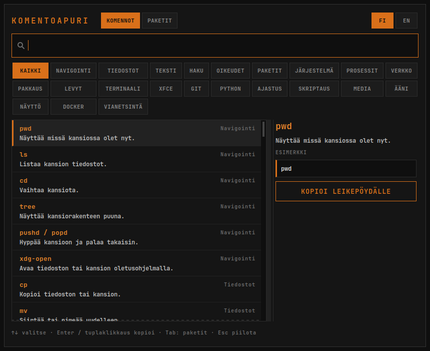
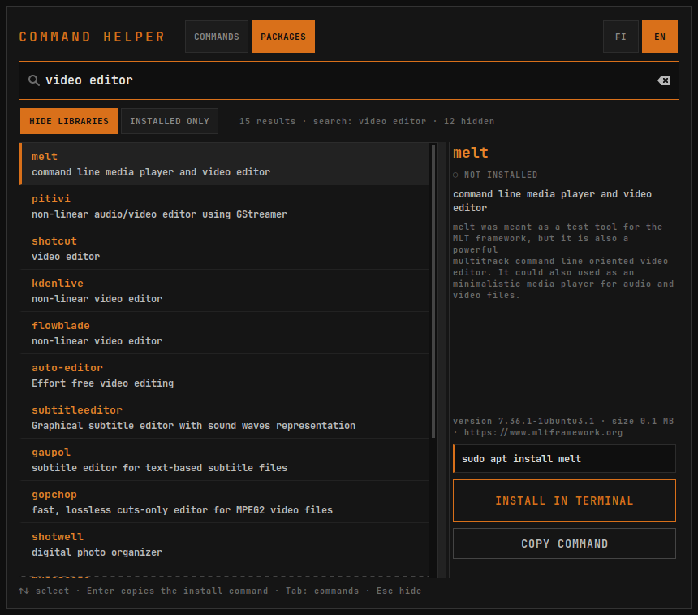

# Linux Command Finder

*Suomeksi: [alempana](#suomeksi)*

A small searchable cheat sheet for Linux commands, plus an app/package search — built for people who
are still learning the terminal. Pop it up with a hotkey, type what you want to do, copy the command.

| Commands (Finnish UI) | Packages (English UI) |
|---|---|
|  |  |

## Features

- **617 commands** in 22 categories (files, text, network, packages, disks, Git, Docker, troubleshooting…),
  each with an explanation and a copyable example. Dangerous commands are flagged.
- **Package search** (apt): find apps without knowing the package name. Finnish search words are
  translated to English automatically (`kuvankäsittely` → `image editor`). Shows installed status,
  description, version and size, and can install/remove in a terminal.
- **Finnish and English UI** — switch with the FI | EN button; the choice is remembered.
- Toggle the window with one hotkey; `Tab` switches between commands and packages, `Esc` hides.
- Dark carbon + orange GTK3 theme.

## Requirements

- Python 3 with GTK3 bindings: `sudo apt install python3-gi gir1.2-gtk-3.0`
- Package search needs `apt-cache` and `dpkg-query` (Debian/Ubuntu and derivatives).
- Tested on Ubuntu 26.04 with XFCE (X11). Should work on any desktop with GTK3.

## Install

```bash
git clone https://github.com/jkmarttinen/linux_command_finder.git
cd linux_command_finder
./install.sh
```

This adds an application-menu launcher and, on XFCE, binds **Super+K**. On other desktops bind a
shortcut to `python3 /path/to/komentoapuri.py` yourself. Running the command again while the app is
open toggles the window.

## Usage

| Key | Action |
|---|---|
| `Super+K` (your shortcut) | show / hide |
| `↑` `↓` | move in the list |
| `Enter` / double-click | copy the command (also to the middle-click selection) |
| `Tab` | switch Commands ⇄ Packages |
| `Esc` | hide |

## Adding commands

Commands live in [`komennot.py`](komennot.py) as `("Category", "command", "explanation", "example")`
(Finnish). Add the English text to [`komennot_en.py`](komennot_en.py) (`SELITYS`, keyed by the command).
UI strings are in [`kieli.py`](kieli.py); the package search logic is in [`paketit.py`](paketit.py).

## Files

```
komentoapuri.py   GTK3 app and styling
komennot.py       command data (Finnish)
komennot_en.py    English translations of the commands
kieli.py          UI strings and language setting
paketit.py        apt package search backend
install.sh        launcher + XFCE shortcut installer
```

---

## Suomeksi

Hakukelpoinen Linux-komentojen ohjekirja ja sovellus-/pakettihaku Linuxia opetteleville. Avaa
pikanäppäimellä, kirjoita mitä haluat tehdä ja kopioi komento.

- **617 komentoa** selityksineen ja esimerkkeineen, vaaralliset merkitty.
- **Pakettihaku**: löydä ohjelmia tuntematta paketin nimeä; suomenkieliset hakusanat käännetään englanniksi.
- **Suomi/englanti**: vaihda kieli FI | EN -painikkeella (muistetaan).
- Asennus: `./install.sh` (lisää käynnistimen ja XFCE:ssä pikanäppäimen **Super+K**).
- Vaatimukset: `sudo apt install python3-gi gir1.2-gtk-3.0`. Pakettihaku toimii Debian/Ubuntu-pohjaisissa.
